# HESAMS — Entity-Relationship Model & Data Dictionary

## 1. ER Diagram (Mermaid)

Paste into any Mermaid renderer (mermaid.live, VS Code, GitHub) to view.

```mermaid
erDiagram
    COMPANIES ||--o{ DEPARTMENTS : has
    DEPARTMENTS ||--o{ EMPLOYEES : employs
    COMPANIES ||--o{ EMPLOYEES : employs
    EMPLOYEES ||--o{ EMPLOYEES : supervises
    EMPLOYEES ||--o{ EMPLOYEE_DOCUMENTS : owns
    EMPLOYEES ||--o{ RFID_CARDS : holds
    RFID_CARDS ||--o{ CARD_ASSIGNMENT_LOG : tracks
    ROLES ||--o{ USERS : assigns
    ROLES ||--o{ ROLE_PERMISSIONS : grants
    PERMISSIONS ||--o{ ROLE_PERMISSIONS : "granted by"
    USERS ||--o{ REFRESH_TOKENS : issues
    EMPLOYEES |o--o| USERS : "may log in as"

    EQUIPMENT_TYPES ||--o{ EQUIPMENT : classifies
    EQUIPMENT_TYPES ||--o{ EQ_TYPE_TRAINING_REQ : requires
    EQUIPMENT_TYPES ||--o{ EQ_TYPE_LICENSE_REQ : requires
    TRAINING_COURSES ||--o{ EQ_TYPE_TRAINING_REQ : "required by"
    TRAINING_COURSES ||--o{ EMPLOYEE_TRAININGS : "completed as"
    LICENSE_TYPES ||--o{ EQ_TYPE_LICENSE_REQ : "required by"
    LICENSE_TYPES ||--o{ EMPLOYEE_LICENSES : "issued as"
    EMPLOYEES ||--o{ EMPLOYEE_TRAININGS : completes
    EMPLOYEES ||--o{ EMPLOYEE_LICENSES : holds

    LOCATIONS ||--o{ EQUIPMENT : hosts
    DEPARTMENTS ||--o{ EQUIPMENT : owns
    EQUIPMENT ||--o{ EQUIPMENT_FILES : has

    EMPLOYEES ||--o{ AUTHORIZATIONS : "granted to"
    EQUIPMENT ||--o{ AUTHORIZATIONS : "scoped to"
    EQUIPMENT_TYPES ||--o{ AUTHORIZATIONS : "scoped to"
    SHIFTS ||--o{ AUTHORIZATIONS : restricts
    LOCATIONS ||--o{ AUTHORIZATIONS : restricts

    RFID_CARDS ||--o{ ACCESS_EVENTS : "scanned in"
    EMPLOYEES ||--o{ ACCESS_EVENTS : triggers
    EQUIPMENT ||--o{ ACCESS_EVENTS : "target of"
    ACCESS_EVENTS ||--o| USAGE_SESSIONS : opens
    EMPLOYEES ||--o{ USAGE_SESSIONS : operates
    EQUIPMENT ||--o{ USAGE_SESSIONS : "used in"
    SHIFTS ||--o{ USAGE_SESSIONS : "worked in"

    EQUIPMENT ||--o{ MAINTENANCE_ORDERS : schedules
    MAINTENANCE_ORDERS ||--o{ MAINTENANCE_PARTS : consumes
    MAINTENANCE_ORDERS ||--o{ MAINTENANCE_ATTACHMENTS : documents
    EMPLOYEES ||--o{ MAINTENANCE_ORDERS : "performed by"

    EQUIPMENT ||--o{ INCIDENTS : "involved in"
    EMPLOYEES ||--o{ INCIDENTS : "involved in"
    LOCATIONS ||--o{ INCIDENTS : "occurred at"
    USERS ||--o{ INCIDENTS : reports

    NOTIFICATION_TEMPLATES ||--o{ NOTIFICATIONS : renders
    USERS ||--o{ NOTIFICATIONS : receives
    USERS ||--o{ AUDIT_LOG : generates
```

## 2. Relationship rules

| Relationship | Cardinality | Rule |
|--------------|-------------|------|
| Employee → RfidCard | 1 : N | Only one card may be Active per employee at a time (enforced in `RfidCardsController.Issue`) |
| Equipment → gate unit | 1 : 1 | `RfidReaderId` is unique; a machine has exactly one reader |
| Employee → Authorization | 1 : N | Scope is either `EquipmentId` **or** `EquipmentTypeId` (CHECK constraint) |
| EquipmentType → TrainingCourse | M : N | Junction `EquipmentTypeTrainingRequirements` |
| EquipmentType → LicenseType | M : N | Junction `EquipmentTypeLicenseRequirements` |
| AccessEvent → UsageSession | 1 : 0..1 | Session created only when `Result = 'Granted'` |
| Equipment → MaintenanceOrder | 1 : N | A lock clears only after a Completed order within 7 days |
| Employee → Employee | 1 : N | Self-referencing supervisor hierarchy, `ON DELETE RESTRICT` |

## 3. Normalization notes (3NF)

- **1NF** — no repeating groups. Multi-valued attributes (documents, files, parts, attachments) are separate tables.
- **2NF** — every non-key attribute depends on the whole key. Junction tables (`RolePermissions`, `EquipmentTypeTrainingRequirements`) hold only the composite key.
- **3NF** — no transitive dependencies. Department name lives only in `Departments`; equipment type name only in `EquipmentTypes`; license type name only in `LicenseTypes`. Training expiry is stored (not derived from the course each read) because a course's validity period may change without invalidating past certificates — this is intentional and not a violation.
- **Deliberate denormalization** — `Equipment.OperatingHours` and `Equipment.CurrentOperatorId` are cached aggregates of `UsageSessions`, maintained transactionally on session close, so the interlock chain never has to aggregate at scan time.

## 4. Data dictionary — key columns

| Table.Column | Type | Notes |
|--------------|------|-------|
| Employees.Status | nvarchar(20) | Active / Suspended / OnLeave / Terminated |
| Employees.MedicalClearanceExpiry | date, null | NULL = clearance not required for this role |
| RfidCards.Status | nvarchar(20) | Active / Inactive / Lost / Expired / Blocked |
| RfidCards.CardType | nvarchar(20) | Permanent / Temporary / Replacement |
| Equipment.Status | nvarchar(25) | Available / InUse / UnderMaintenance / Locked / OutOfService |
| Equipment.MaintenanceLocked | bit | Hard interlock; only `maintenance.unlock` clears it |
| Equipment.RfidReaderId | nvarchar(50), unique | Must match `READER_ID` flashed to the gate unit |
| Authorizations.AuthType | nvarchar(20) | Permanent / Temporary (Temporary requires ValidTo) |
| AccessEvents.Result | nvarchar(10) | Granted / Denied |
| AccessEvents.DenialReason | nvarchar(60) | CardNotFound, CardInactiveOrExpired, EmployeeInactive, MedicalExpired, TrainingMissingOrExpired, LicenseMissingOrExpired, NotAuthorized, EquipmentInUse, EquipmentUnavailable, MaintenanceLock, UnknownReader |
| AccessEvents.ValidationTrace | nvarchar(max) | JSON array of every gate evaluated |
| MaintenanceOrders.Status | nvarchar(20) | Scheduled / InProgress / Completed / Cancelled / Overdue |
| Incidents.Status | nvarchar(20) | Open / UnderInvestigation / PendingApproval / Closed |
| AuditLog.OldValue / NewValue | nvarchar(max) | JSON snapshots for change forensics |

## 5. Index strategy

Covering indexes exist for the interlock chain's hot path (card UID lookup, employee trainings/licenses by employee, active authorizations) and for the dashboard's time-series queries (`AccessEvents.EventAt DESC`, filtered index on denied events). Filtered indexes on `IsActive = 1` and `Status = 'Active'` keep the authorization lookup small regardless of historical volume.
